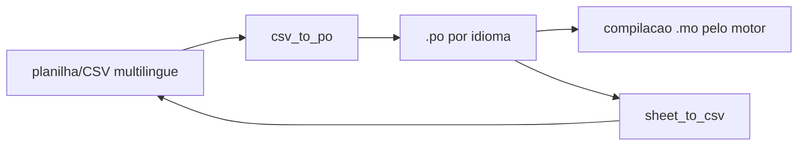

# localization-toolkit

> Pipeline de localização de jogo nas duas direções: CSV multilíngue → arquivos .po por idioma, e .po → CSV para edição.

     

    

## O problema

Tradução de jogo morre em planilha. Estas ferramentas convertem a planilha da equipe de locução em gettext compilável pelo motor, e o caminho inverso para o tradutor editar — sem ninguém precisar abrir terminal.

## Estrutura

```
localization-toolkit/
└── l10n/
    ├── sheet_to_csv.py   varre os .po por idioma e consolida num unico CSV
    ├── csv_to_po.py      CSV -> .po (PT/ES/FR/RU/PL/DE) com Plural-Forms por idioma
    └── csv_to_po_v2.py   CSV -> .po (7 idiomas, inclui EN) com cabecalho parametrizado
```

## Fluxo



## Destaques técnicos

### 🗂️ Metadados preservados nos dois sentidos

`Key`, `SourceLocation`, referência `#:` e `msgctxt` sobrevivem à ida e à volta **para os seis idiomas da v1** (PT, ES, FR, RU, PL, DE). Limitação real: `sheet_to_csv.py` tem os nomes dos `.po` fixados no código e **não inclui o inglês** — o `Game_EN_eng.po` gerado pela v2 não volta ao CSV. Para voltar o EN é preciso adicionar o arquivo à lista.

### 🌐 `Plural-Forms` específicos por idioma

A v1 escreve a diretiva correta para cada idioma, incluindo as regras de plural complexas de **russo e polonês** (três formas plurais). A v2 unificou o cabeçalho e **regrediu** nesse ponto — mantenho as duas versões para que a diferença fique visível.

### 🖥️ GUI para quem não é técnico

`csv_to_po.py` e `csv_to_po_v2.py` usam `askopenfilename` + `askdirectory` (você escolhe a pasta de saída e os `.po` são nomeados pelo idioma); `asksaveasfilename` aparece só no caminho de volta, em `sheet_to_csv.py`, para nomear o CSV consolidado. `messagebox` dá retorno por arquivo gerado. Desenhado para a equipe de locução usar sem linha de comando.

### ⚙️ Zero dependências

Só `csv` e `tkinter` da stdlib (`threading` aparece apenas em `sheet_to_csv.py`) — roda em qualquer máquina Windows sem instalar nada.

## ⚠️ Limitação conhecida

O parsing de `.po` é manual (varredura de linha). Ele **não** trata `msgid`/`msgstr` multilinha, aspas escapadas, comentários de tradutor nem fuzzy entries. Para uso sério, a substituição direta é [`polib`](https://pypi.org/project/polib/), mantendo a mesma interface CSV↔`.po`.

### Como rodar

```bash
# CSV multilingue -> .po por idioma (v1: Plural-Forms especificos, 6 idiomas)
python l10n/csv_to_po.py

# mesma coisa na v2 (7 idiomas, inclui EN; cabecalho unificado)
python l10n/csv_to_po_v2.py

# .po -> CSV consolidado para edicao na planilha
python l10n/sheet_to_csv.py
```

Todos abrem uma janela Tkinter para escolher o arquivo e a pasta de saída — não há
parâmetro de linha de comando. A função `gerar_po_de_traducao(caminho_csv, pasta_saida)`
também é chamável por código para uso em pipeline de build.

## Testes e lint

```bash
pip install -r requirements.txt -r requirements-dev.txt
ruff check .          # lint
pytest                # 17 testes
```

O CI roda lint, `compileall` e pytest em `windows-latest` (Python 3.11 e 3.12) a cada
push — Windows porque este código usa `pywin32`, `wmi` e `winreg`, que não existem em Linux.

A configuração do ruff está em `pyproject.toml` e declara, com o motivo de cada uma, as
regras que **não** estou corrigindo agora. Prefiro isso a escolher um subconjunto de regras
que passa por acaso.

## Setup

```bash
python -m venv .venv
source .venv/bin/activate
pip install -r requirements.txt
```

Sem dependências externas — apenas stdlib.
---

## ⚠️ Sobre o que isto é — e sobre titularidade

São **scripts internos de TI** escritos durante meu trabalho em um estúdio de jogos, **sanitizados** para publicação: tokens, senhas, hosts internos, IPs, nomes de projeto e dados de terceiros foram substituídos por variáveis de ambiente ou placeholders. O estúdio não é nomeado aqui de propósito.

Duas coisas que quero deixar claras em vez de deixar você descobrir:

- **Não estou reivindicando direitos sobre este código.** Parte dele foi produzida como funcionário, e direitos sobre trabalho de empregador pertencem ao empregador. Publico como demonstração de como eu resolvi os problemas — para leitura e estudo, não como software livre. Não há licença concedida (ver `LICENSE`).
- **Não são produtos prontos para produção.** São demonstrações de abordagem técnica, com limitações declaradas nas seções acima. Copie `.env.example` para `.env` e preencha antes de rodar qualquer coisa — e rode só contra infraestrutura sua.
